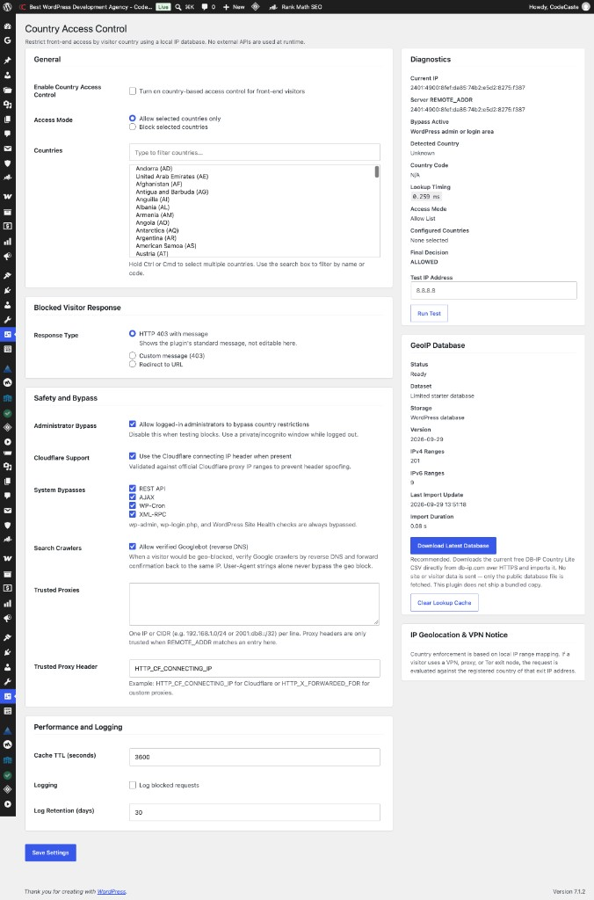

# Country Access Control by CodeCaste

Restrict front-end access by visitor country using a local IP geolocation database. No external APIs are required at runtime.

## Features

- Country allowlist or blocklist for front-end visitors
- Local IP geolocation database (no third-party API calls at runtime)
- Crawler-aware handling for legitimate bots
- Admin settings, logging, and cache controls
- Built for WordPress sites that need simple geo access control

## Requirements

- WordPress 5.8+
- PHP 7.4+

## Installation

1. Download or clone this repository into `wp-content/plugins/codecaste-country-access-control`
2. Activate **Country Access Control by CodeCaste** in WordPress
3. Open the plugin settings to choose allowed or blocked countries

## WordPress.org

- Slug: `codecaste-country-access-control`
- Plugin page: https://wordpress.org/plugins/codecaste-country-access-control/

## Repository

- GitHub: https://github.com/code-caste/codecaste-country-access-control
- Maintainer: [Bhushan-Gohel](https://github.com/Bhushan-Gohel)
- Website: [CodeCaste](https://www.codecaste.com)

## License

GPLv2 or later — see [LICENSE](LICENSE).
